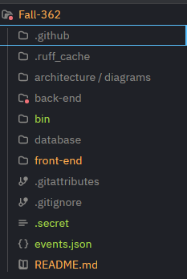
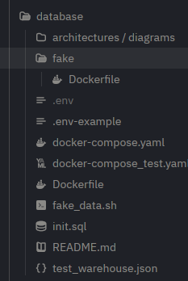
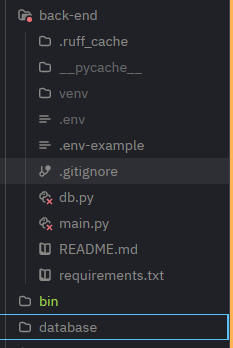
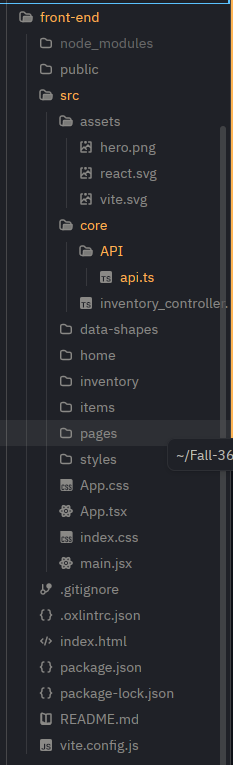

# Fall-362
Inventory management
The system that help manage inventories, support basic feature from add/remove/modify inventory and items to advance features like report and import/export.
# Table of contents
- Discription
- Tech task
- Feature
- Visual diagram

# Project Description
This inventory management system provides expanding companies on older inventory managing systems with a clean and modern application that makes it easier to oversee various warehouse inventories. It helps staff manage stock, track product availability by location, and maintain consistent inventory records as the business grows.

# Tech Stack:

 - Python -- Backend Logic

 - FastAPI - -HTTP API routes

 - Pydantic -- Validates request data

 - psycop2 -- PostgreSQL connection

 - PostgreSQL -- relational database

 - Docker -- Runs the database container

 - Typescript + React -- Frontend UI

# FEATURES

**Inventory Management**
- Add new items to inventory 
- Remove items from inventory
- Update item information
- Search for items using their name or SKU

Multiple Warehouse Management

- Manage inventory across different warehouses
- View inventory in different cities
- Transfer items across different warehouses
- Update inventory quantities after transferring

Inventory Alerts

- Notify the user when item is running low or out of stock

Discounts on Items

- Allow admin to discount items (specifically old items)
- Display discounted prices

# Visual Diagram
**overall struture** 

**database** - the setup of database include container startup command and fake data.

**Back-end** - including business logic codes, requirement dependencies and database connection
 

**Front-end** - including interaction UI, connection logic to backend

